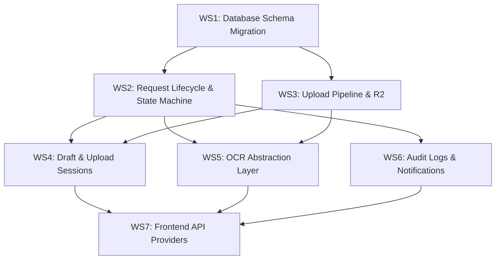

> Historical plan: Demo and Hybrid providers have since been removed. Both web portals now use their existing API providers exclusively; the provider-mode switches and demo-specific checks below are obsolete. See [SETUP.md](../SETUP.md) for current configuration.

# Phase 7B — Backend Integration, Document Processing Pipeline & Transaction Engine

Phase 7B transitions the Parishioner Portal from a demonstration frontend into a fully functional production client connected to the TESTIMONIUM Backend. This plan replaces all demo/stub API providers with live backend integrations and establishes the document processing pipeline, cloud storage workflows, transaction state machine, and OCR-assisted payment verification.

---

## User Review Required

> [!IMPORTANT]
> **Backend lives outside the frontend workspace.** Phase 7B requires changes to both `testimonium-backend` and `testimonium-parishioner-web`. All backend changes target `c:\Users\me\Documents\testimonium\testimonium-backend`. Please confirm you're comfortable with modifications to both projects.

> [!WARNING]
> **Database schema migration required.** Workstream 1 introduces 5 new Prisma models and modifies `DocumentRequest`. This will generate a new Prisma migration that must be applied against Supabase. Verify you have a recent database backup before we proceed.

> [!IMPORTANT]
> **Existing admin portal endpoints remain untouched.** The current `documentRequestRoutes.js` serves the admin portal (staff-only via `checkRole`). Phase 7B creates a separate **parishioner-scoped** route file (`parishionerRequestRoutes.js`) mounted at a new path, so existing admin routes are unaffected.

---

## Open Questions

> [!IMPORTANT]
> **1. OCR Provider Selection:** Phase 7B spec lists Tesseract and "Server OCR" as initial options, with Gemini Vision / Google Vision as future options. Which provider should we implement first?
> - **Option A:** Tesseract.js (runs server-side, no external API cost, lower accuracy)
> - **Option B:** Google Cloud Vision API (higher accuracy, requires GCP credentials)
> - **Option C:** Stub OCR provider only (returns `NEEDS_MANUAL_REVIEW` always, defer real OCR to a later sprint)
>
> Recommendation: **Option C** — ship the abstraction layer now with a stub, add a real provider once receipts are flowing.

> [!IMPORTANT]
> **2. Tracking Number Format:** The demo provider uses `TX-2026-XXXXX`. The backend `DocumentRequest` model currently has no `trackingNumber` column. Should we:
> - **Option A:** Generate tracking numbers as `TX-{YEAR}-{zero-padded request_id}` (deterministic, derived from DB ID)
> - **Option B:** Generate UUIDs / nanoid-based tracking codes (opaque, collision-free)

> [!IMPORTANT]
> **3. Parishioner parish selection:** Currently `DocumentRequest` requires a `parishId`. The parishioner web portal's request wizard lets users select a parish. Should parishioners be allowed to submit to **any** parish, or only their **assigned** parish (from `User.parishId`)?

> [!IMPORTANT]
> **4. Events & Announcements source:** The backend has no dedicated Announcement model or public Event model. The frontend demo provider has rich event data. For Phase 7B, should we:
> - **Option A:** Create backend endpoints for events/announcements (adds scope)
> - **Option B:** Keep events/announcements on demo providers for now, focus Phase 7B strictly on the request/document pipeline
>
> Recommendation: **Option B** — keep the hybrid provider approach for events/announcements, focusing Phase 7B on the core transactional pipeline.

---

## Proposed Changes

Changes are organized into 7 workstreams, ordered by dependency (database first, then backend services, then frontend integration).

---

### Workstream 1 — Database Schema Evolution

Extend the Prisma schema with normalized tables for file tracking, payment transactions, receipt uploads, OCR results, and request history. Also add a `trackingNumber` field to `DocumentRequest`.

#### [MODIFY] [schema.prisma](file:///c:/Users/me/Documents/testimonium/testimonium-backend/prisma/schema.prisma)

Add the following new models and modify `DocumentRequest`:

**Modify `DocumentRequest`:**
- Add `trackingNumber String @unique` column
- Add `applicantName String` — the person on whose behalf the request is made
- Add `relationship String?` — relationship of requester to applicant
- Add relations to new models: `requestFiles`, `paymentTransactions`, `requestHistory`

**New model: `RequestFile`** (replaces the flat `requirements` relation for richer metadata)
```
model RequestFile {
  id          Int     @id @default(autoincrement())
  requestId   Int
  category    String  // "primary" | "supporting" | "receipt"
  fileName    String
  r2ObjectKey String
  mimeType    String?
  fileSize    Int?
  uploadedAt  DateTime @default(now())
  request     DocumentRequest @relation(...)
}
```

**New model: `PaymentTransaction`**
```
model PaymentTransaction {
  id              Int     @id @default(autoincrement())
  requestId       Int
  amount          Decimal?
  provider        String? // "gcash" | "maya" | "bank_transfer"
  referenceNumber String?
  status          PaymentVerificationStatus // PENDING | VERIFIED | REJECTED
  verifiedById    Int?
  verifiedAt      DateTime?
  createdAt       DateTime @default(now())
  request         DocumentRequest @relation(...)
  receipts        ReceiptUpload[]
}
```

**New model: `ReceiptUpload`**
```
model ReceiptUpload {
  id                    Int     @id @default(autoincrement())
  paymentTransactionId  Int
  r2ObjectKey           String
  fileName              String
  mimeType              String?
  fileSize              Int?
  uploadedAt            DateTime @default(now())
  transaction           PaymentTransaction @relation(...)
  ocrResult             OcrResult?
}
```

**New model: `OcrResult`**
```
model OcrResult {
  id                Int     @id @default(autoincrement())
  receiptUploadId   Int     @unique
  referenceNumber   String?
  amount            String?
  paymentDate       String?
  provider          String?
  confidenceScore   Float?
  rawText           String? @db.Text
  processedAt       DateTime @default(now())
  receipt           ReceiptUpload @relation(...)
}
```

**New model: `RequestHistory`** (immutable audit trail per request)
```
model RequestHistory {
  id          Int      @id @default(autoincrement())
  requestId   Int
  actorId     Int?
  action      String
  oldStatus   String?
  newStatus   String?
  remarks     String?  @db.Text
  createdAt   DateTime @default(now())
  request     DocumentRequest @relation(...)
  actor       User? @relation(...)
}
```

**New enum: `PaymentVerificationStatus`**
```
enum PaymentVerificationStatus {
  PENDING
  VERIFIED
  REJECTED
}
```

---

### Workstream 2 — Backend Request Lifecycle & State Machine

Build the core parishioner-facing request endpoints with strict state transition enforcement.

#### [NEW] [validators/requestSchemas.js](file:///c:/Users/me/Documents/testimonium/testimonium-backend/validators/requestSchemas.js)

Zod schemas for:
- `createRequestSchema` — validates `parishId`, `documentType`, `applicantName`, `relationship`, `purpose`
- `updateRequestStatusSchema` — validates status transition payloads

#### [NEW] [services/RequestStateMachine.js](file:///c:/Users/me/Documents/testimonium/testimonium-backend/services/RequestStateMachine.js)

Pure function defining legal state transitions:

```
Allowed transitions map:
  NEW         → PENDING
  PENDING     → UNDER_REVIEW, CANCELLED
  UNDER_REVIEW → AWAITING_INFORMATION, PAYMENT_PENDING, REJECTED
  AWAITING_INFORMATION → UNDER_REVIEW, CANCELLED
  PAYMENT_PENDING → PAYMENT_VERIFICATION, CANCELLED
  PAYMENT_VERIFICATION → PROCESSING, PAYMENT_PENDING
  PROCESSING  → READY_FOR_PICKUP
  READY_FOR_PICKUP → COMPLETED
  (any)       → EXPIRED  (system-only)
```

Exports `canTransition(from, to)` and `getAvailableTransitions(from)`.

#### [NEW] [services/ParishionerRequestService.js](file:///c:/Users/me/Documents/testimonium/testimonium-backend/services/ParishionerRequestService.js)

Business logic for parishioner-scoped operations:
- `create(userId, data)` — creates draft, generates tracking number, initial status `PENDING`, creates `RequestHistory` entry
- `listByUser(userId, filters)` — returns paginated requests owned by the authenticated parishioner
- `getByTrackingNumber(trackingNumber, userId)` — lookup with ownership enforcement
- `getById(requestId, userId)` — detail view with files, payment, history
- `submitDraft(requestId, userId)` — finalizes a draft request
- `cancelRequest(requestId, userId)` — parishioner-initiated cancellation with state machine check

#### [NEW] [repositories/ParishionerRequestRepository.js](file:///c:/Users/me/Documents/testimonium/testimonium-backend/repositories/ParishionerRequestRepository.js)

Prisma query layer for parishioner-scoped request operations. All queries filter by `userId` to enforce ownership.

#### [NEW] [controllers/ParishionerRequestController.js](file:///c:/Users/me/Documents/testimonium/testimonium-backend/controllers/ParishionerRequestController.js)

Express controller functions:
- `create` — `POST /`
- `list` — `GET /`
- `getByTracking` — `GET /tracking/:trackingNumber`
- `getById` — `GET /:id`
- `submitDraft` — `POST /:id/submit`
- `cancel` — `POST /:id/cancel`

#### [NEW] [routes/parishionerRequestRoutes.js](file:///c:/Users/me/Documents/testimonium/testimonium-backend/routes/parishionerRequestRoutes.js)

New Express route file mounted at `/api/v1/requests`. Uses `authenticateFirebaseToken` (no role restriction — open to all authenticated users including `PARISHIONER`).

#### [MODIFY] [server.js](file:///c:/Users/me/Documents/testimonium/testimonium-backend/server.js)

- Import and mount `parishionerRequestRoutes` at `${apiVersion}/requests`
- Import and mount `parishionerFileRoutes` at `${apiVersion}/requests` (nested under `:id/files`)

---

### Workstream 3 — Multer Upload Pipeline & Cloudflare R2 Streaming

Implement defensive file upload validation and R2 storage with organized folder structure.

#### [MODIFY] [middlewares/uploadMiddleware.js](file:///c:/Users/me/Documents/testimonium/testimonium-backend/middlewares/uploadMiddleware.js)

Expand from the current 4-line stub to a full validation pipeline:
- Configure allowed MIME types: `application/pdf`, `image/png`, `image/jpeg`, `image/webp`
- Configure allowed extensions: `.pdf`, `.png`, `.jpg`, `.jpeg`, `.webp`
- Configurable max file size (default 10MB from env `MAX_UPLOAD_SIZE_MB`)
- Configurable max file count per request (default 10 from env `MAX_UPLOAD_FILES`)
- `fileFilter` function that rejects executables, archives, unknown MIME types, zero-byte files
- Export specialized middleware functions: `uploadRequestFiles` (multi-file), `uploadReceiptFile` (single file)

#### [NEW] [services/FileUploadService.js](file:///c:/Users/me/Documents/testimonium/testimonium-backend/services/FileUploadService.js)

Orchestrates validated uploads into R2 with deterministic folder structure:
```
documents/{requestId}/primary/
documents/{requestId}/supporting/
documents/{requestId}/receipts/
```

Methods:
- `uploadRequestFile(requestId, file, category)` — streams buffer to R2, creates `RequestFile` DB record
- `uploadReceiptFile(paymentTransactionId, file)` — streams to R2, creates `ReceiptUpload` DB record
- `deleteFile(r2ObjectKey)` — removes from R2 and DB
- `generateR2Key(requestId, category, fileName)` — deterministic key generation

#### [NEW] [controllers/ParishionerFileController.js](file:///c:/Users/me/Documents/testimonium/testimonium-backend/controllers/ParishionerFileController.js)

Controller for file upload endpoints:
- `uploadFiles` — `POST /requests/:id/files` (multipart, up to N files)
- `uploadReceipt` — `POST /requests/:id/receipt` (single file)

#### [NEW] [routes/parishionerFileRoutes.js](file:///c:/Users/me/Documents/testimonium/testimonium-backend/routes/parishionerFileRoutes.js)

Nested routes under `/api/v1/requests/:id/files` and `/api/v1/requests/:id/receipt`.

---

### Workstream 4 — Draft Submission & Upload Sessions

Enable parishioners to save progress and resume later.

#### [MODIFY] [services/ParishionerRequestService.js](file:///c:/Users/me/Documents/testimonium/testimonium-backend/services/ParishionerRequestService.js)

Add draft workflow methods:
- Requests start with status `PENDING` (acts as a "draft" until explicitly submitted)
- Introduce a `isDraft Boolean @default(true)` field on `DocumentRequest` (or use a `DRAFT` status value — see design decision below)
- `saveDraftData(requestId, userId, partialData)` — updates registrant info on a draft
- `finalizeDraft(requestId, userId)` — validates all required fields/files are present, transitions to `PENDING`

**Design decision:** Rather than adding a new `DRAFT` enum value (which would require a schema migration for the enum), we'll use a boolean `isDraft` column. Requests with `isDraft=true` are not visible to staff. When the parishioner finalizes, `isDraft` flips to `false` and the request appears in the staff queue.

#### [NEW] [services/UploadSessionService.js](file:///c:/Users/me/Documents/testimonium/testimonium-backend/services/UploadSessionService.js)

Manages upload sessions tied to a request draft:
- `createSession(requestId, userId)` — generates a session ID, stores temporarily
- `addFileToSession(sessionId, file)` — uploads to a temp R2 prefix
- `finalizeSession(sessionId)` — moves files from temp prefix to permanent location
- `cleanupExpiredSessions()` — cron-compatible cleanup for abandoned sessions

---

### Workstream 5 — OCR Receipt Verification (Abstraction Layer)

Build a provider-agnostic OCR service architecture.

#### [NEW] [services/ocr/OcrProviderInterface.js](file:///c:/Users/me/Documents/testimonium/testimonium-backend/services/ocr/OcrProviderInterface.js)

Defines the OCR contract:
```js
// Every provider must implement:
async extractFromReceipt(imageBuffer, mimeType) → {
  referenceNumber, amount, paymentDate, provider, confidenceScore, rawText
}
```

#### [NEW] [services/ocr/StubOcrProvider.js](file:///c:/Users/me/Documents/testimonium/testimonium-backend/services/ocr/StubOcrProvider.js)

Default provider returning `{ confidenceScore: 0, ...nullFields }` — always routes to manual review. Serves as a safe fallback until a real OCR engine is connected.

#### [NEW] [services/ocr/TesseractOcrProvider.js](file:///c:/Users/me/Documents/testimonium/testimonium-backend/services/ocr/TesseractOcrProvider.js)

*(Created but not active until OCR provider question is resolved)*
Uses `tesseract.js` to extract text, then regex-parses for GCash/Maya reference patterns.

#### [NEW] [services/ReceiptVerificationService.js](file:///c:/Users/me/Documents/testimonium/testimonium-backend/services/ReceiptVerificationService.js)

Orchestration layer:
1. Receives uploaded receipt image buffer
2. Calls configured OCR provider
3. Stores `OcrResult` in database
4. If `confidenceScore >= threshold` AND reference/amount match → auto-verify payment
5. Otherwise → flag for manual coordinator review
6. Creates `RequestHistory` entry for the verification event
7. Triggers notification to parishioner

---

### Workstream 6 — Audit Logging, Notifications & Request History

Wire up automatic audit trails and user-facing notifications for every state change.

#### [MODIFY] [services/AuditLogService.js](file:///c:/Users/me/Documents/testimonium/testimonium-backend/services/AuditLogService.js)

Extend to support request-specific history logging. Add method:
- `logRequestTransition(requestId, actorId, oldStatus, newStatus, remarks, tx)` — writes to both `ActivityLog` and `RequestHistory`

#### [NEW] [services/RequestNotificationService.js](file:///c:/Users/me/Documents/testimonium/testimonium-backend/services/RequestNotificationService.js)

Triggers `IN_APP` notifications to the parishioner on key events:
| Event | Notification Title |
|---|---|
| Request submitted | "Request Submitted Successfully" |
| Payment requested | "Payment Required for Your Request" |
| Receipt verified | "Payment Receipt Verified" |
| Request approved (→ PROCESSING) | "Your Request Has Been Approved" |
| Ready for pickup | "Your Document is Ready for Pickup" |
| Rejected | "Your Request Has Been Rejected" |
| Completed | "Request Completed" |

Each notification creates a `Notification` DB record linked to the parishioner's `userId`.

---

### Workstream 7 — Frontend API Provider Implementation

Replace all stub `throw new Error('API provider not implemented')` implementations with real HTTP calls. Pages remain unchanged — they continue using `services.xxx` from the provider factory.

#### [NEW] [src/api/client.ts](file:///c:/Users/me/Documents/testimonium/testimonium-parishioner-web/src/api/client.ts)

Shared Axios/fetch wrapper:
- Base URL from `VITE_API_BASE_URL` env var
- Automatic `Authorization: Bearer <firebaseIdToken>` header injection
- Standard response unwrapping (`{ success, data, message, errors }`)
- Typed error handling with standardized `ApiError` class
- Token refresh on 401

#### [MODIFY] [.env.example](file:///c:/Users/me/Documents/testimonium/testimonium-parishioner-web/.env.example)

Add: `VITE_API_BASE_URL=http://localhost:5000/api/v1`

---

#### [MODIFY] [src/types/index.ts](file:///c:/Users/me/Documents/testimonium/testimonium-parishioner-web/src/types/index.ts)

Expand types to match new backend models:
- Expand `RequestStatus` to include all `DocumentRequestStatus` values: `'pending' | 'under-review' | 'awaiting-information' | 'payment-pending' | 'payment-verification' | 'processing' | 'ready' | 'completed' | 'rejected' | 'cancelled' | 'expired'`
- Add `RequestFile` interface
- Add `PaymentTransaction` interface
- Add `RequestHistoryEntry` interface
- Expand `SacramentalRequest` with `files`, `payments`, `history` arrays
- Add `isDraft` flag to `SacramentalRequest`

#### [MODIFY] [src/providers/types.ts](file:///c:/Users/me/Documents/testimonium/testimonium-parishioner-web/src/providers/types.ts)

Expand `IRequestProvider` with new methods:
```ts
interface IRequestProvider {
  createRequest(data): Promise<SacramentalRequest>;
  getRequests(filters?): Promise<SacramentalRequest[]>;
  getRequestByTrackingNumber(tn: string): Promise<SacramentalRequest | null>;
  getRequestById(id: string): Promise<SacramentalRequest | null>;  // NEW
  uploadFiles(requestId: string, files: File[]): Promise<RequestFile[]>;  // NEW
  uploadReceipt(requestId: string, file: File): Promise<void>;  // NEW
  saveDraft(requestId: string, data: Partial<SacramentalRequest>): Promise<void>;  // NEW
  submitDraft(requestId: string): Promise<SacramentalRequest>;  // NEW
  cancelRequest(requestId: string): Promise<void>;  // NEW
}
```

---

#### [MODIFY] [src/providers/api/request.ts](file:///c:/Users/me/Documents/testimonium/testimonium-parishioner-web/src/providers/api/request.ts)

Full implementation using the API client:
- `createRequest` → `POST /requests`
- `getRequests` → `GET /requests`
- `getRequestByTrackingNumber` → `GET /requests/tracking/:tn`
- `getRequestById` → `GET /requests/:id`
- `uploadFiles` → `POST /requests/:id/files` (multipart FormData)
- `uploadReceipt` → `POST /requests/:id/receipt` (multipart FormData)
- `saveDraft` → `PATCH /requests/:id/draft`
- `submitDraft` → `POST /requests/:id/submit`
- `cancelRequest` → `POST /requests/:id/cancel`

#### [MODIFY] [src/providers/api/profile.ts](file:///c:/Users/me/Documents/testimonium/testimonium-parishioner-web/src/providers/api/profile.ts)

Implement `getProfile` → `GET /auth/login` (re-uses existing auth endpoint which returns user profile)
Implement `updateProfile` → `PATCH /users/:id` (or a new parishioner self-update endpoint)

#### [MODIFY] [src/providers/api/parish.ts](file:///c:/Users/me/Documents/testimonium/testimonium-parishioner-web/src/providers/api/parish.ts)

Implement `getParishes` → `GET /parishes`
Implement `getParishById` → `GET /parishes/:id`

> [!NOTE]
> The existing `/parishes` route is restricted to `DIOCESE_COORDINATOR`. We need to add a **public/parishioner-accessible** read-only parish listing endpoint (or relax the `GET` role restriction).

#### [MODIFY] [src/providers/api/notification.ts](file:///c:/Users/me/Documents/testimonium/testimonium-parishioner-web/src/providers/api/notification.ts)

Implement:
- `getNotifications` → `GET /notifications`
- `markAsRead` → `PATCH /notifications/:id/read`
- `markAllAsRead` → `PATCH /notifications/read-all`

#### [MODIFY] [src/providers/api/scheduler.ts](file:///c:/Users/me/Documents/testimonium/testimonium-parishioner-web/src/providers/api/scheduler.ts)

Implement:
- `getAppointments` → `GET /schedule-requests`
- `getAvailableSlots` → `GET /schedule-requests/available-slots?parishId=&date=`
- `bookAppointment` → `POST /schedule-requests`

#### [MODIFY] [src/providers/api/auth.ts](file:///c:/Users/me/Documents/testimonium/testimonium-parishioner-web/src/providers/api/auth.ts)

Implement using Firebase client SDK (already handled by `AuthContext`). The API provider delegates to `AuthContext` methods. May remain thin since auth is primarily client-side Firebase.

#### [MODIFY] [src/providers/api/event.ts](file:///c:/Users/me/Documents/testimonium/testimonium-parishioner-web/src/providers/api/event.ts)

**Depends on Open Question #4.** If events stay demo-only, these remain stubs and the hybrid provider continues routing events to demo.

#### [MODIFY] [src/providers/api/announcement.ts](file:///c:/Users/me/Documents/testimonium/testimonium-parishioner-web/src/providers/api/announcement.ts)

Same as events — depends on scope decision.

#### [MODIFY] [src/providers/api/chat.ts](file:///c:/Users/me/Documents/testimonium/testimonium-parishioner-web/src/providers/api/chat.ts)

Implement `sendMessage` → `POST /chatbot` (or keep as demo if chatbot backend isn't ready).

#### [MODIFY] [src/providers/api/map.ts](file:///c:/Users/me/Documents/testimonium/testimonium-parishioner-web/src/providers/api/map.ts)

Implement `getParishCoordinates` by deriving from parish data (the backend `Parish` model doesn't currently store coordinates — may need to extend or derive from address).

#### [MODIFY] [src/providers/demo/request.ts](file:///c:/Users/me/Documents/testimonium/testimonium-parishioner-web/src/providers/demo/request.ts)

Extend demo provider to support the new `IRequestProvider` methods (file upload simulation, draft workflow, cancel) so Demo Mode remains fully functional.

#### [MODIFY] [src/providers/hybrid/index.ts](file:///c:/Users/me/Documents/testimonium/testimonium-parishioner-web/src/providers/hybrid/index.ts)

Update hybrid mappings to route request operations through `apiServiceProvider.request` while keeping events/chat on demo.

#### [MODIFY] [src/hooks/useService.ts](file:///c:/Users/me/Documents/testimonium/testimonium-parishioner-web/src/hooks/useService.ts)

Add new hooks:
- `useRequest(id)` — fetches single request detail with files, payments, history
- `useRequestTracking(trackingNumber)` — tracking lookup
- New mutation helpers for `uploadFiles`, `submitDraft`, `cancelRequest`

---

### Backend Access Control Adjustment

#### [NEW] [routes/parishionerParishRoutes.js](file:///c:/Users/me/Documents/testimonium/testimonium-backend/routes/parishionerParishRoutes.js)

A read-only parish listing route accessible to **all authenticated users** (including `PARISHIONER` role). The existing `parishRoutes.js` stays restricted to `DIOCESE_COORDINATOR` for write operations.

- `GET /api/v1/parishioner/parishes` → list all active parishes (read-only)
- `GET /api/v1/parishioner/parishes/:id` → get single parish detail

#### [MODIFY] [server.js](file:///c:/Users/me/Documents/testimonium/testimonium-backend/server.js)

Mount the new parishioner-accessible routes.

---

## Execution Order



| Phase | Workstream | Est. Files | Dependency |
|-------|-----------|------------|------------|
| 1 | WS1: Schema Migration | 1 modified | None |
| 2 | WS2: State Machine + Request Endpoints | 5 new, 1 modified | WS1 |
| 3 | WS3: Upload Pipeline | 3 new, 1 modified | WS1 |
| 4 | WS4: Draft Workflow | 2 modified, 1 new | WS2 + WS3 |
| 5 | WS5: OCR Layer | 4 new | WS2 + WS3 |
| 6 | WS6: Audit + Notifications | 1 modified, 1 new | WS2 |
| 7 | WS7: Frontend Providers | ~15 modified, 1 new | WS2-WS6 |

---

## Verification Plan

### Automated Tests

```bash
# Backend — verify schema compiles
cd testimonium-backend && npx prisma validate

# Backend — generate client after migration
npx prisma generate

# Frontend — verify TypeScript compiles
cd testimonium-parishioner-web && npm run build
```

### Manual Verification

**Document Submission Pipeline:**
- [ ] Submit a new request via API Mode → verify DB record + tracking number
- [ ] Upload multiple files → verify R2 folder structure: `documents/{id}/supporting/`
- [ ] Refresh browser mid-upload → verify draft persists
- [ ] Resume and finalize draft → verify status transitions

**State Machine:**
- [ ] Attempt `PENDING → READY_FOR_PICKUP` directly → expect 400 rejection
- [ ] Walk through full legal lifecycle → verify each transition succeeds
- [ ] Verify `RequestHistory` records generated at each step

**Cloud Storage:**
- [ ] Verify R2 objects have correct keys and metadata
- [ ] Verify file metadata stored in `RequestFile` table matches R2

**OCR (when enabled):**
- [ ] Upload GCash receipt screenshot → verify OCR result record created
- [ ] Upload unreadable image → verify `NEEDS_MANUAL_REVIEW` flagged

**Provider Modes:**
- [ ] `VITE_PROVIDER_MODE=demo` → all demo data works unchanged
- [ ] `VITE_PROVIDER_MODE=api` → all calls route to backend
- [ ] `VITE_PROVIDER_MODE=hybrid` → requests use API, events use demo

**Build Verification:**
```bash
# Frontend
cd testimonium-parishioner-web && npm run build
# Expect: Zero TypeScript errors, Zero build warnings

# Backend
cd testimonium-backend && npx tsc --noEmit
# Expect: Zero TypeScript errors
```
